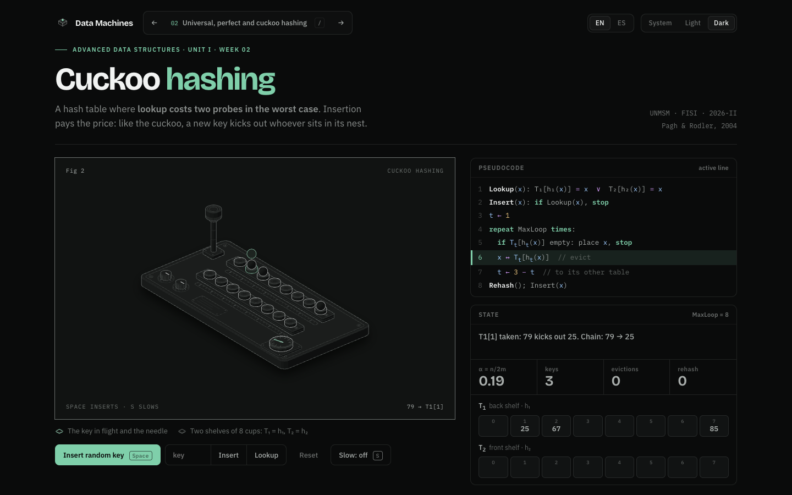

<p align="center">
  
</p>

<h1 align="center">Data Machines</h1>

<p align="center">
  Advanced Data Structures, one interactive machine per week.<br>
  UNMSM · FISI · 2026-II · English and Spanish
</p>

<p align="center">
  
</p>

## What it is

Each week of the course syllabus is a small physical machine you can operate. You insert a key, and you watch it move. The pseudocode line that is running lights up, and the table state updates beside it. Below the machine, the lesson covers the theory, the math and exercises for class.

| Unit | Weeks |
|---|---|
| I. Hashing and probabilistic structures | Amortized analysis, cuckoo hashing, Bloom filters, union-find |
| II. Text and indexing | Tries and Patricia, suffix arrays, inverted index |
| III. Spatial structures | Segment trees, interval trees, KD-trees, quadtrees |
| IV. External memory and distribution | B+ trees, persistence, consistent hashing |

## Moving around

| Key | Action |
|---|---|
| `Space` | Run the main action of the machine |
| `S` | Slow motion |
| `[` `]` | Previous and next lesson |
| `/` or `⌘K` | Jump to any lesson |

## Run it

```bash
bun install
bun run dev      # http://localhost:4321/en/
bun run build    # static site in dist/
```

## How it is built

- [Astro](https://astro.build) with `/en/` and `/es/` routes.
- Figures drawn with the [Anatomy](https://skills.wheresryan.sh/anatomy) kit by Ryan ([@wheresryan22](https://github.com/wheresryan22)), vendored under `vendor/anatomy/` with its MIT license. The static parts render at build time. The moving parts redraw in the browser with the same kit.
- One file per machine in `src/lessons/`, with its geometry, its live code and the lesson text in both languages. To add a week, add a file and register it in `src/lessons/index.mjs`.
